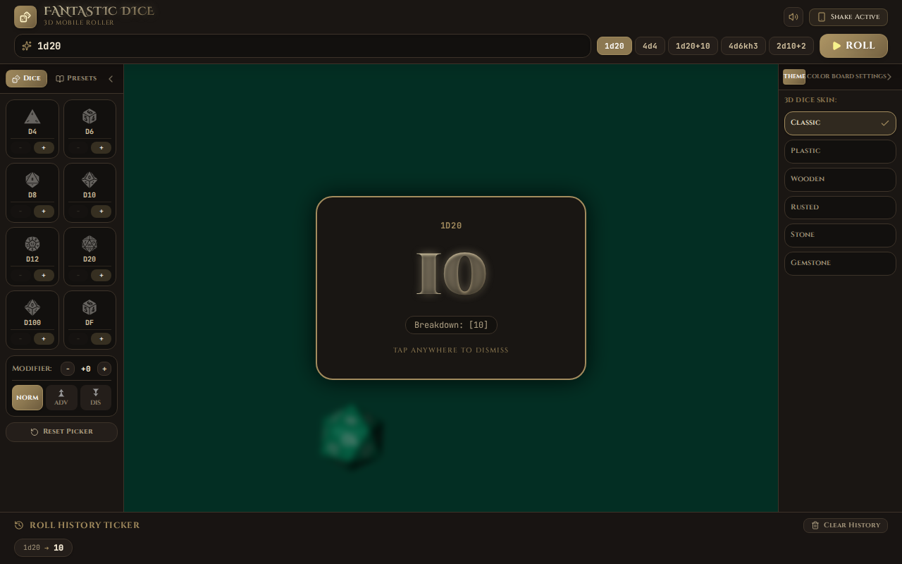

# Fancy Dice

Fancy Dice is a standalone, installable 3D dice roller for tabletop role-playing games. It runs as a Progressive Web App (PWA) in the browser and on supported mobile devices. Dice physics, notation parsing, roll results, themes, audio and interaction state run locally in the app.

## Features

- **3D dice physics** — d4, d6, d8, d10, d12, d20, percentile and Fate dice, powered by @3d-dice/dice-box, Three.js and Ammo.js.
- **Dice notation** — standard dice formulas, modifiers, keep/drop operators and exploding dice. Invalid notation is rejected before a physical roll starts.
- **Compact navigation** — the notation field and Roll action stay visible in the top bar. Dice tools, presets, themes, color and settings live in one overlay menu; the dice stage remains mounted beneath it.
- **Custom appearance** — dice materials, custom color selection and tabletop felt themes.
- **Roll history** — a compact horizontal history bar supports repeat rolls and clearing the current session history.
- **Motion and feedback** — browser DeviceMotionEvent support for shake-to-roll, Web Audio sound, and vibration through the browser vibration API when available.
- **Installable PWA** — standalone display, app icons, offline app-shell caching and responsive portrait/landscape layouts.

## Product scope

Fancy Dice is an independent dice roller. It does not currently provide accounts, cloud sync, multiplayer, remote rolling, Bluetooth pairing or a backend service.

A possible future integration with Artificer is documented as a concept only in [FUTURE_COMPANION_INTEGRATION.md](docs/FUTURE_COMPANION_INTEGRATION.md). No companion protocol or network integration is implemented or part of the current roadmap.

## Technology

- React 19, TypeScript and Vite
- Tailwind CSS and Lucide React
- @3d-dice/dice-box, Three.js and Ammo.js WebAssembly physics
- Web Audio API for sound synthesis
- Browser DeviceMotionEvent and navigator.vibrate APIs for motion and vibration feedback
- Vite-generated PWA service-worker precache

Capacitor Core, CLI, Android, Motion and Haptics packages are present in the dependency manifest and a Capacitor configuration exists. The current runtime still uses browser motion and vibration APIs; the Capacitor Motion and Haptics plugins are not integrated. A native Android project is not committed or currently shipped.

## Development

Requirements: Node.js 18 or newer and npm.

Install dependencies:

    npm install

Start the development server:

    npm run dev

Run the TypeScript check:

    npm run lint

Run automated tests:

    npm test

Create a production build:

    npm run build

The local development server is available at http://localhost:3000.

## Install the Android PWA

The published application is available at:

https://japiohopman.github.io/fancy-dice/

1. Open the URL in Chrome on Android while online.
2. Open Chrome's menu and select **Install app** or **Add to Home screen**.
3. Launch Fancy Dice from the home screen.

The PWA uses the device's current orientation; the manifest does not request a fixed orientation. The service worker caches the app shell and generated JavaScript/CSS bundles, then caches same-origin game assets as they are requested. The first visit requires an internet connection. Complete one online launch before relying on offline use.

The app's browser motion, sound, vibration, WebGL rendering, safe-area spacing and offline behaviour should be checked on a physical device. Browser emulation does not replace that check.

For the repeatable checklist, see [PWA_ANDROID_TEST_GUIDE.md](docs/PWA_ANDROID_TEST_GUIDE.md).

## Documentation

- [ARCHITECTURE.md](docs/ARCHITECTURE.md) — active component map, state ownership and runtime flow.
- [ANDROID_ROADMAP.md](docs/ANDROID_ROADMAP.md) — current PWA delivery and conditional native Android path.
- [ROADMAP.md](docs/ROADMAP.md) — prioritized active issues and product direction.
- [MASTER_AUDIT.md](docs/MASTER_AUDIT.md) — evidence-based technical status and remaining verification.
- [PERFORMANCE_BASELINE.md](docs/PERFORMANCE_BASELINE.md) — DiceBox startup/bundle baseline and runtime measurement procedure.
- [INTERACTION_PERFORMANCE.md](docs/INTERACTION_PERFORMANCE.md) — audio and color-wheel interaction changes and measurement procedure.
- [FUTURE_COMPANION_INTEGRATION.md](docs/FUTURE_COMPANION_INTEGRATION.md) — future concept only; not implemented or in scope.

## License

MIT License.
